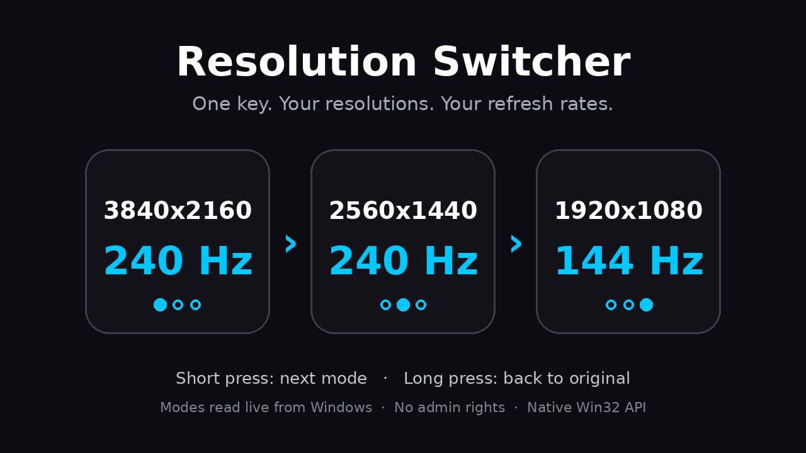

# Resolution Switcher

**One key. Your resolutions. Your refresh rates.**

A Stream Dock plugin for Ajazz and Mirabox devices (such as the Ajazz AKP03E) that switches your screen resolution and refresh rate with a single key press. You build the list yourself, from the modes Windows actually reports for your screen.



## Features

- **Cycle through your own list**: each short press switches to the next mode, then wraps around.
- **Long press to go back**: hold the key for 0.7 s to restore your original resolution.
- **Real modes only**: the list comes from Windows, so you can only pick modes your screen and GPU support. No typing errors, no broken modes.
- **Live key display**: the key shows the current resolution, the refresh rate and its position in your list. It updates when the resolution changes from somewhere else (Windows Settings, a game, another key).
- **Multi-screen**: target the primary screen (default) or any attached screen. Put one key per screen if you want.
- **Same result as Windows Settings**: modes are applied the same way as the Windows display settings, so they survive fullscreen games and alt-tab. A temporary mode, reverted at reboot, is also available.
- **Lightweight**: native Win32 calls, no PowerShell, no extra program, no admin rights. The plugin does nothing at startup and never delays Windows shutdown.

## Requirements

| | |
|---|---|
| OS | Windows 10 or 11 (x64 or ARM64) |
| Software | Stream Dock / Ajazz software **3.10.188.226 or newer** (built-in Node.js 20) |
| Device | Any Stream Dock compatible device with keys |

macOS is not supported.

## Installation

### From the store
Search for **Resolution Switcher** in the Space / Store tab of the Stream Dock software and click Install.

### Manual
1. Download `com.xamyp.resolutionswitcher.sdPlugin.zip` from the [Releases](../../releases) page.
2. Close the Stream Dock software.
3. Extract the `com.xamyp.resolutionswitcher.sdPlugin` folder to:
   ```
   %AppData%\HotSpot\StreamDock\plugins\
   ```
4. Start the software again. The plugin appears in the **Resolution Switcher** category.

## Usage

1. Drag **Cycle resolution** onto a key.
2. In the settings panel, pick a **Screen** (primary by default).
3. Choose a mode in the drop-down list (grouped by resolution, every refresh rate listed) and press **+**. Repeat for each mode you want in the cycle.
4. Reorder with ▲ ▼, remove with ✕.
5. Press the key:
   - **Short press**: next mode in the list. If the current mode is not in the list, the first mode is applied.
   - **Long press (0.7 s)**: back to the original resolution.

### Settings

| Setting | Options | Notes |
|---|---|---|
| Screen | Primary screen, or any attached screen | The list of available modes depends on the selected screen. |
| Cycle list | Modes reported by Windows | Each entry is a resolution + refresh rate pair. |
| Apply mode | **Like Windows (permanent)** (default) / Temporary (until reboot) | Temporary changes can be reverted by Windows when a fullscreen game starts or loses focus. |
| Scaling | **Let Windows decide** (default) / Stretch / Center | Only matters for resolutions below the native resolution of the screen. *Let Windows decide* gives the same result as Windows Settings. |
| Original resolution | Restore / Save current | The original is saved automatically right before the first change made by the plugin. *Save current* overwrites it. |

### Key display

```
 3840x2160     current resolution
  240 Hz       current refresh rate
  ● ○ ○        position in your list (hollow dots = mode not in the list)
```

## Troubleshooting

| Problem | What to do |
|---|---|
| The key shows a warning triangle | The list is empty, the mode is no longer supported by the screen, or the driver refused it. Open the settings and check the list. |
| A mode is missing from the drop-down list | Only modes reported by the GPU driver for the selected screen are shown (32-bit, progressive). Check that the screen is connected with the right cable/port, or add a custom resolution in your GPU control panel, then reopen the settings. |
| The resolution goes back after alt-tab in a game | Set **Apply mode** to *Like Windows (permanent)*. |
| The image is blurry or stretched at low resolution | Try another **Scaling** option, or set scaling in your GPU control panel and keep *Let Windows decide*. |
| The plugin does not appear | Check the software version (3.10.188.226 or newer) and restart the software after installing. |

Logs are written to `%AppData%\HotSpot\StreamDock\plugins\com.xamyp.resolutionswitcher.sdPlugin\plugin\log\plugin.log`.

## Privacy

The plugin works fully offline. It does not collect, store or send any data. Settings (your list of modes and the original resolution) are stored locally by the Stream Dock software.

## Development

```
com.xamyp.resolutionswitcher.sdPlugin/
├── manifest.json            Plugin and action definition
├── en.json / fr.json        Localized names
├── plugin/
│   ├── index.js             Stream Dock connection, key logic, key rendering
│   ├── display.js           Win32 display API (koffi)
│   └── node_modules/        ws, koffi (Windows binaries only)
├── propertyInspector/       Settings panel (HTML/CSS/JS)
└── static/                  Icons
```

- Runtime: the Node.js 20 runtime bundled with Stream Dock (`"Nodejs": { "Version": "20" }` in the manifest).
- Display API: `EnumDisplayDevicesW`, `EnumDisplaySettingsExW`, `ChangeDisplaySettingsExW` (tested with `CDS_TEST` before applying), called through [koffi](https://koffi.dev).
- Debugging: open `http://localhost:23519/` while the Stream Dock software is running.

To install dependencies after cloning:

```
cd com.xamyp.resolutionswitcher.sdPlugin/plugin
npm install --omit=dev
```

## Third-party components

- [ws](https://github.com/websockets/ws), MIT License
- [koffi](https://koffi.dev), MIT License

## License

MIT, see [LICENSE](LICENSE).
